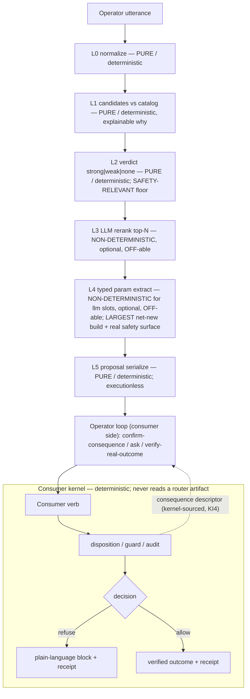

# intent-router — architecture (full-system design of record)

> The durable design SoT for intent-router, promoted out of the ephemeral v8 plan so any future
> session resumes deterministically without re-architecting. The machine-checkable behavior surface
> is pinned in `contracts/*.json`; the numbered rules/invariants live in `CONSTITUTION.md` (+ its
> contract) and are referenced BY NUMBER here (CR#, KI#), never re-listed. Read this instead of
> re-deriving the design.

## The two-decision split (why this repo exists)

"Fully architect upfront" and "commit to build the whole system now" are **different decisions**.
v8 separates them:

- **Architect fully now (P0):** every expensive-to-retrofit interface — the five schemas, the
  invariants, the named extension seams, the full operator surface — is specified and frozen upfront
  as committed repo artifacts, with a machine-checkable proof (`tests/test_additive_compat.py` +
  `contracts/additive-manifest.json`) that every deferred phase only ADDS to the v1 contracts.
- **Build incrementally, gated:** the mechanisms (LLM enrichment, calibration, scheduler,
  resilience, full surface) are built phase-by-phase behind evidence gates (`status.yml`).
- **Ship kernel safety independently, first:** the consumer's kernel-safety lanes (AWA K0/K1/K2)
  deliver their guarantee with **zero router code in the tree** — if the router build slips or is
  cancelled, the safety fix already shipped.

**Rule:** if we cannot prove today that a deferred phase is additive to the v1 contracts, we are not
architecture-complete and building more is premature.

## What the router is (one sentence)

A consumer hands the router a plain-language operator utterance; the router matches it against that
consumer's own **catalog** of verbs and returns a structured **proposal** (verb, params, start
point, safety class, confidence, verdict, why, missing params, whether to confirm). **The router
proposes; the consumer's kernel decides.** (CR1, CR2.)

## Pipeline L0→L5 (determinism class per layer)



| Layer | Determinism | Role | On/off |
|---|---|---|---|
| **L0 normalize** | pure | lowercase/synonym/acronym normalization (may vendor agent-route's `score.py`) | always on |
| **L1 candidates** | pure | score utterance vs catalog entries; produce an explainable `why` | always on |
| **L2 verdict** | pure | `strong` / `weak` / `none` — **the safety-relevant output** | always on |
| **L3 rerank** | LLM (non-det) | optional rerank of the top-N candidates | OFF-able (CR8) |
| **L4 param extract** | deterministic for destructive slots; LLM allowed elsewhere | typed parameter extraction | OFF-able (CR8, CR9) |
| **L5 serialize** | pure | emit the `intent-proposal` envelope; **no execution field exists** (CR1) | always on |

- **L0–L2 + L5 must produce a valid conservative proposal with L3/L4 OFF** — the offline golden-set
  + degrade property (CR8). L2 verdict is the safety-relevant output.
- **L4 param extraction is the dominant net-new build and the real safety surface.** A wrong
  parameter on a destructive verb is worse than a wrong verb. It is NOT a generalization of
  agent-route (which has no param extraction). Deterministic extraction (regex / enum / repo-resolver)
  is **required** for any slot feeding a destructive verb; an LLM-inferred destructive param requires
  explicit operator confirmation of the literal value (CR9, enforced via the catalog's per-param
  `extractor`/`confirm_literal` fields added in R2).

## Contracts (five schemas; behavior-frozen, additive-within-v1)

The interface is `contracts/`. Each contract freezes a **schema string** + a **required-key floor**
+ **enum floors** (values only EXTEND). Removal/rename/retype needs a v2 (there is no v2 for this
work — CR4). See each file for the full floor + the `deferred_additions` roadmap.

| Contract | Owner | P0 freeze | Purpose |
|---|---|---|---|
| `intent-catalog/v1` | consumer's source tree (read-only to router) | **FROZEN** | per-verb description: `verb, aliases, examples, param_schema{name,type,required,enum?,source?}, preconditions, safety_class(read\|write\|destructive), tool_path(cli\|mcp\|hook), start_point_rules, plain_label, consequence_copy` |
| `intent-map/v1` | store (router-private projection) | **FROZEN** | learned intent: `intent_key, utterance_examples, target_verb, param_bindings, weight, confidence, hit_count, last_used, outcome_stats, source(seed\|manual\|feedback), version` — ONE schema, a `source` field, no phrasebook migration |
| `intent-proposal/v1` | router↔consumer interface | **PROVISIONAL** (freeze → A0) | `consumer, verb, params, start_point, safety_class, tool_path, confidence, verdict(strong\|weak\|none), why, missing_params, requires_confirmation` |
| `intent-feedback/v1` | append-only JSONL (router-private truth) | **FROZEN** | `ts, consumer, catalog_version, utterance, proposal, operator_choice, correction?, verdict, confidence, outcome, session_id` |
| `intent-constitution/v1` | shared | **FROZEN** | machine-checkable router rules + kernel invariants + machine-checks + egress banned-term tiers |

**Freeze timing (obey exactly).** `intent-catalog/v1`, `intent-map/v1`, `intent-feedback/v1`, and
the constitution contract are **freeze-locked in P0**. `intent-feedback/v1` MUST be frozen before C0
writes event #1 (else accumulated learning is unreplayable = silent loss). `intent-proposal/v1` is
**DEFINED in P0 but its envelope freeze is DEFERRED to A0** (marked PROVISIONAL, `freeze_exempt`),
because it is the highest re-architecture risk: it is only proven correct once a real consumer
exercises it against a hand-written fixture. Freezing it prematurely would likely force a breaking
v2.

**Catalog schema carries `plain_label` + `consequence_copy` from day one**, so a jargon leak on a
PM-facing surface is a schema-validation failure, not luck (the egress gate, CR10).

## State layout (JSON/JSONL, not SQLite)

Single-operator, append-only, event-sourced. No SQLite/daemon → no WAL-on-synced-disk risk, no
migrations, no background process. All under `${XDG_STATE_HOME:-~/.local/state}/intent-router/` on
**local disk** (700 dirs / 600 files), never a cloud-synced/network path.

```
${XDG_STATE_HOME:-~/.local/state}/intent-router/
  events.jsonl                 the TRUTH — append-only intent-feedback/v1 event log (event-sourced)
  <consumer>/map.json          derived projection of the map (atomic write; rebuildable from events)
  <consumer>/map.snapshots/<ts>.json   versioned snapshots for restore
  <consumer>/phrasebook.yml    the reviewed overlay (source=manual entries; C0 reviewable-first)
  synonyms.yml                 L0 normalization inputs
  acronyms.yml                 L0 normalization inputs
  index.json                   fast-lookup index (rebuildable)
  doctor/last-run.json         last doctor snapshot
```

Catalogs + golden sets live in the **consumer's source tree**, read-only to the router. The router
state is **machine-local and private, never published to a shared repo** (CR3).

## Full operator surface (declared in P0; later verbs stub to "not-yet")

The surface is declared now so it stays stable across the multi-session build. In P0 every verb is a
thin not-yet stub with **no execution path** (CR1; `tests/test_cli_stub.py`).

- **CLI `intent`:** read-only now (`map`, `explain`, `catalog-verify`, `doctor`); later
  (`feedback`, `phrasebook {diff,review,apply}`, `calibrate`, `seed`, `snapshot`, `restore`,
  `rebuild`, `status`).
- **MCP:** a **read-only mirror only** (`intent_map` / `intent_explain` / `intent_catalog_verify` /
  `intent_doctor`) — **no mutating tool path by construction**.
- **Operator skill/rule (consumer-side):** hear → map → confirm-consequence → consumer verb →
  verify-real-outcome → narrate → record-feedback.
- **Hooks:** `stop` (event-trigger calibration) + `sessionStart` (re-heal) — **OFF until C1**.
- **Doctor/dashboard:** catalog validity, store schema version, golden-set pass rate, calibration
  freshness, behavior-hash drift, false-confidence metrics, scheduler/hook installed; canvas is
  additive (reuses the local-jobs dashboard). It **never gates** a safety or proof phase.

## Calibration engine (event-sourced; reviewable-first → automatic)

- `events.jsonl` is the truth; `map.json` is a derived projection (rebuildable).
- Deterministic weighting: frequency + recency exponential-decay + outcome; **corrections
  supersede** on an `intent_key` conflict.
- Golden-set regression gate: a calibration pass that would regress the golden set **aborts and
  keeps last-good** (the golden-set invariant, frozen in P0 — see `tests/golden/README.md`).
- **C0 reviewable-first** (operator-approvable phrasebook diff; `source in {seed, manual}`), then
  **C1 automatic** (`source=feedback` active) — the C0→C1 promotion is a GATE (CR7), not a
  reopenable design choice, and requires: real-use trial passed, false-strong rate below threshold,
  **destructive near-miss count = 0** in the trial window (>0 HALTS calibration enablement),
  reversible phrasebook trusted. Because all three `source` values and every weighting/outcome field
  are frozen in v1 now, C0→C1 is an **activation, not a migration**.

## Resilience

- **Behavior-hash drift detection** (normalizing environment noise) flags a store that no longer
  matches its expected behavior.
- **Self-repair:** rebuild-from-events / restore-snapshot / re-seed / `sessionStart` re-heal.
- **Corrupt store → conservative fallback:** run L0–L2 on the catalog alone → conservative
  proposals; degrade to ask / a secondary explicit path; **never guess a destructive action** (CR6).

## Safety separation (structural, not just behavioral)

Referenced by number from `CONSTITUTION.md`:

- **Kernel-first (KI1):** the consumer's safety guarantee holds engine-off AND router-off; the
  consumer's own `verify` passes with the router uninstalled.
- **Structural non-contamination (KI2):** the kernel gate never reads any router artifact — a
  standing test greps the consumer kernel for any import/read of router state = zero, forever.
- **Behavioral non-contamination (KI3):** a confidence-1.0 proposal produces the IDENTICAL kernel
  decision as the hand-typed equivalent; the router can never turn a kernel refuse into an allow.
- **Kernel-sourced consequence (KI4):** consequence-based confirmations are sourced from the KERNEL
  disposition's consequence descriptor `{destroys_unshared_work, irreversible, affects_shared_ref}`,
  not from the router and not from a verb list. The confirmation content is deterministic, so the
  confirm text itself is never router-in-the-safety-path.
- **Prompt-injection (CR5):** repo/transcript/catalog-example content is data, never instructions; it
  can never change a proposal's `safety_class`.
- **Off-switch (CR6):** uninstall the router → the operator loop degrades to ask + a secondary
  explicit path; the guard still denies / refuses / audits.

## System-wide operator egress gate (CR10)

Jargon-free + honest-confidence is a CI-tested egress gate over **all seven** PM-facing surfaces:
chat loop, guard block message, dashboard canvas, MCP approval labels, discard/save confirmation,
doctor/status, detection receipts/timeline.

- **Banned terms, three tiers** (defined in the constitution contract): Tier A generic mechanism
  words; Tier B git-workflow words (universal); Tier C concrete on-disk leakers, which are
  **consumer-contributed** via the consumer's catalog/egress config so the shared router names no
  single consumer's tokens. For the first consumer (AWA), Tier C includes its concrete tokens (its
  worktree/lease/bundle/mode tool + flag names, "primary checkout", etc.) — contributed by AWA, not
  hardcoded here.
- The catalog schema carries `plain_label` + `consequence_copy`, so a leak is a schema-validation
  failure.
- **Honest confidence, never a bare color:** every PM-facing status expresses "what I checked and
  what I couldn't." No green pill / doctor may imply a safety guarantee the PM cannot audit; a
  partially-built protection names its hole in plain words.
- MCP consent requires plain intent ("Temporarily stop protecting this repo?"), never a tool name.

## Repo-home (LOCKED — BOTH)

Repo-home is **BOTH** (the "repo vs shelf" question was a false binary; AWA precedent):

1. **Own repo** `KleinPerkins/intent-router` — code, CI, contracts, releases (this repo).
2. **A Flavor-2 `standalone-release` pointer** at `capabilities/skills/global/tools/intent-router` —
   discoverability + WF1 enrollment only; it carries the pinned release pointer, never runtime bytes.

**P0 creates ONLY (1)** plus this repo's own `meta.yml` (`kind: tool`, Flavor-2). Creating the (2)
shelf pointer and WF1 registry enrollment is **deferred to phase R-surface-complete** — this keeps
P0 zero-link trivially clean (nothing references the downstream governed edge yet) and lets an
immutable release commit be pinned at the shelf when the runtime actually exists.

**`kind: tool`, NOT `mcp` (LOCKED).** AWA precedent: `global/tools/awa` ships an MCP server but is a
`tool`. Classifying intent-router as `mcp` would permanently misroute downstream governed-repo
vendoring. See `meta.yml`.

## Cross-session resume (how this carries)

The chat/plan is ephemeral; this repo is durable. Any two sessions from the same commit:

1. read `RESUME.md` (current phase, entry-precondition pass/fail, EXACT next action, model),
2. run `make status-verify` (recomputes the ledger vs disk/tests so it cannot lie) and `make verify`,
3. read `ARCHITECTURE.md` + `contracts/` + `CONSTITUTION.md` for the locked design,
4. execute the current phase's gate.

No transcript replay, no re-architecting.

## Locked decisions (do not re-litigate)

Router proposes / never executes / never authorizes (CR1, CR2). Kernel-first: engine-off AND
router-off (KI1). Shared-first; AWA is the first consumer. Repo-home = BOTH. `kind: tool`. Name
`intent-router`, CLI `intent`. One store schema with a `source` field. JSON/JSONL not SQLite.
Contracts additive-within-v1 (no v2). Five-outcome operator model + banned-term list extend
additively. Router state machine-local / private, never published. Calibration reviewable-first (C0)
→ automatic (C1); promotion is a gate.

## Non-goals

No fusing "architect fully" with "build everything now"; deferred phases must be provably additive.
No router in the authorization chain; no router artifact read by the kernel; no LLM in the
deterministic safety path. No SQLite/daemon. No automatic transcript mining without explicit,
per-run, revocable consent; no auto weight changes before C1. No frozen-contract v1 removal/rename.
No PM-facing workflow requiring Tier A/B/C vocabulary; no green status implying an unauditable safety
guarantee.
